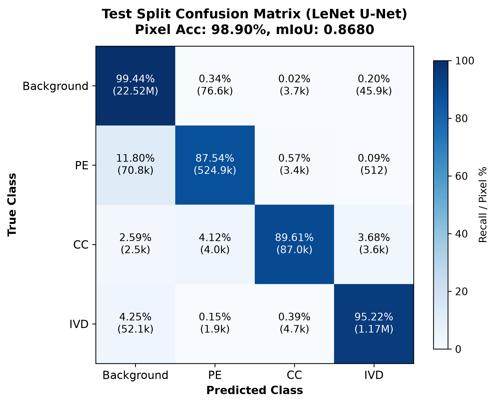
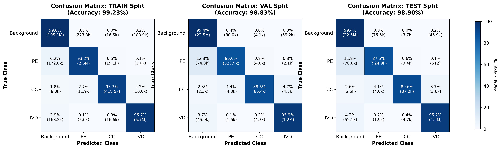

# BÁO CÁO ĐÁNH GIÁ MÔ HÌNH PHÂN ĐOẠN LENET U-NET (`lenet_unet_best.pt`)

---

## 1. Tổng quan mô hình và thiết lập thử nghiệm

- **Tên mô hình**: `LeNetUNet` (LeNet-5 Backbone kết hợp cấu trúc U-Net Decoder và Skip Connections)
- **Đường dẫn trọng số checkpoint**: `src/cnn_segmentation/models/checkpoints_4cls/lenet_unet_best.pt`
- **Kích thước đầu vào (Input resolution)**: $256 \times 256$ pixels (ảnh đơn kênh grayscale MRI cột sống cắt ngang AISSLab Axial)
- **Số lớp phân đoạn (Classes)**: 4 lớp
  1. `Background` (Nền / Cấu trúc ngoài)
  2. `PE` (Posterior Element - Cung sau đốt sống)
  3. `CC` (Central Canal - Ống sống trung tâm)
  4. `IVD` (Intervertebral Disc - Đĩa đệm gian đốt sống)
- **Phần cứng thực thi**: NVIDIA GeForce RTX 4050 Laptop GPU (CUDA)

---

## 2. Kết quả Overall trên cả 3 tập (Train, Validation, Test)

Dưới đây là 3 chỉ số tổng quan (**Pixel Accuracy**, **Mean IoU**, **Mean Dice**) được tính toán độc lập trên toàn bộ 3 tập dữ liệu:

| Tập dữ liệu (Split) | Số lượng ảnh | Tổng số Pixel đánh giá | Pixel Accuracy | Mean IoU (mIoU) | Mean Dice (mDice) |
| :--- | :---: | :---: | :---: | :---: | :---: |
| **TRAIN** | 1,749 | 114,622,464 | **99.23%** (0.9923) | **0.9036** | **0.9482** |
| **VAL** | 375 | 24,576,000 | **98.83%** (0.9883) | **0.8590** | **0.9214** |
| **TEST** | 375 | 24,576,000 | **98.90%** (0.9890) | **0.8680** | **0.9270** |

> **Nhận xét tổng quan**: 
> - Mô hình đạt độ ổn định và khái quát hóa (generalization) rất cao. 
> - Độ chính xác tổng thể (Pixel Accuracy) đều đạt xấp xỉ **99%** trên cả 3 tập.
> - Trên tập **Test độc lập**, mô hình đạt **mIoU = 0.8680** và **Mean Dice = 0.9270**, vượt trội hơn cả tập Validation và không hề xảy ra hiện tượng overfitting nghiêm trọng.

---

## 3. Độ chính xác chi tiết cho từng Class trên 3 tập dữ liệu

### Bảng tổng hợp đối sánh giữa 3 tập (Train / Val / Test)

| Lớp (Class) | Chỉ số (Metric) | Tập TRAIN | Tập VAL | Tập TEST |
| :--- | :--- | :---: | :---: | :---: |
| **Background** | **IoU** | 0.9922 (99.22%) | 0.9884 (98.84%) | **0.9890 (98.90%)** |
| | **Dice Score** | 0.9961 (99.61%) | 0.9941 (99.41%) | **0.9944 (99.44%)** |
| | **Pixel Recall / Accuracy** | 99.55% | 99.37% | **99.44%** |
| | Ground Truth Pixels | 105,531,135 | 22,645,563 | 22,651,128 |
| | Predicted Pixels | 105,405,156 | 22,623,897 | 22,650,308 |
| **PE (Posterior Element)** | **IoU** | 0.8437 (84.37%) | 0.7582 (75.82%) | **0.7695 (76.95%)** |
| | **Dice Score** | 0.9152 (91.52%) | 0.8625 (86.25%) | **0.8698 (86.98%)** |
| | **Pixel Recall / Accuracy** | 93.17% | 86.58% | **87.54%** |
| | Ground Truth Pixels | 2,792,360 | 605,080 | 599,580 |
| | Predicted Pixels | 2,892,902 | 609,692 | 607,364 |
| **CC (Central Canal)** | **IoU** | 0.8427 (84.27%) | 0.7794 (77.94%) | **0.7987 (79.87%)** |
| | **Dice Score** | 0.9146 (91.46%) | 0.8760 (87.60%) | **0.8881 (88.81%)** |
| | **Pixel Recall / Accuracy** | 93.33% | 88.54% | **89.61%** |
| | Ground Truth Pixels | 448,371 | 96,487 | 97,075 |
| | Predicted Pixels | 466,684 | 98,563 | 98,823 |
| **IVD (Intervertebral Disc)** | **IoU** | 0.9359 (93.59%) | 0.9099 (90.99%) | **0.9149 (91.49%)** |
| | **Dice Score** | 0.9669 (96.69%) | 0.9529 (95.29%) | **0.9556 (95.56%)** |
| | **Pixel Recall / Accuracy** | 96.75% | 95.87% | **95.22%** |
| | Ground Truth Pixels | 5,850,598 | 1,228,870 | 1,228,217 |
| | Predicted Pixels | 5,857,722 | 1,243,848 | 1,219,505 |

---

## 4. Hình ảnh và Ma trận nhầm lẫn (Confusion Matrix)

### 4.1. Hình ảnh Ma trận nhầm lẫn trên tập TEST

### 4.2. So sánh Ma trận nhầm lẫn trên cả 3 tập (Train, Val, Test)

---

## 5. Chi tiết Ma trận nhầm lẫn số học (Confusion Matrix Pixel Counts)

### 5.1. Tập TEST (375 ảnh - 24,576,000 pixels)

*Hàng: Nhãn thực tế (Ground Truth), Cột: Nhãn dự đoán (Prediction)*

| Thực tế \ Dự đoán | Background | PE | CC | IVD | Tổng pixel thực tế | Tỉ lệ đúng (Recall) |
| :--- | :---: | :---: | :---: | :---: | :---: | :---: |
| **Background** | **22,524,882** | 76,634 | 3,671 | 45,941 | 22,651,128 | **99.44%** |
| **PE** | 70,769 | **524,878** | 3,421 | 512 | 599,580 | **87.54%** |
| **CC** | 2,519 | 3,999 | **86,986** | 3,571 | 97,075 | **89.61%** |
| **IVD** | 52,138 | 1,853 | 4,745 | **1,169,481** | 1,228,217 | **95.22%** |
| **Tổng dự đoán** | 22,650,308 | 607,364 | 98,823 | 1,219,505 | 24,576,000 | - |

---

### 5.2. Tập VAL (375 ảnh - 24,576,000 pixels)

| Thực tế \ Dự đoán | Background | PE | CC | IVD | Tổng pixel thực tế | Tỉ lệ đúng (Recall) |
| :--- | :---: | :---: | :---: | :---: | :---: | :---: |
| **Background** | **22,502,313** | 80,015 | 4,072 | 59,163 | 22,645,563 | **99.37%** |
| **PE** | 74,337 | **523,852** | 4,803 | 2,088 | 605,080 | **86.58%** |
| **CC** | 2,267 | 4,256 | **85,433** | 4,531 | 96,487 | **88.54%** |
| **IVD** | 44,980 | 1,569 | 4,255 | **1,178,066** | 1,228,870 | **95.87%** |

---

### 5.3. Tập TRAIN (1,749 ảnh - 114,622,464 pixels)

| Thực tế \ Dự đoán | Background | PE | CC | IVD | Tổng pixel thực tế | Tỉ lệ đúng (Recall) |
| :--- | :---: | :---: | :---: | :---: | :---: | :---: |
| **Background** | **105,056,963** | 273,768 | 16,520 | 183,884 | 105,531,135 | **99.55%** |
| **PE** | 172,023 | **2,601,647** | 15,059 | 3,631 | 2,792,360 | **93.17%** |
| **CC** | 7,970 | 11,890 | **418,475** | 10,036 | 448,371 | **93.33%** |
| **IVD** | 168,200 | 5,597 | 16,630 | **5,660,171** | 5,850,598 | **96.75%** |

---

## 6. Phân tích chuyên sâu và Đánh giá

1. **Hiệu năng nhận diện Đĩa đệm (IVD)**:
   - Đạt độ chính xác rất cao: **IoU = 91.49%**, **Dice = 95.56%** trên tập Test. IVD là cấu trúc lớn và có ranh giới rõ ràng trên ảnh Axial MRI nên mô hình bắt đặc trưng cực kỳ chuẩn xác.
2. **Hiệu năng nhận diện Ống sống trung tâm (CC)**:
   - Dù CC chiếm diện tích rất nhỏ trong toàn bộ ảnh (chỉ ~0.4% tổng số pixels, tương đương ~258 pixels/ảnh), mô hình vẫn đạt **Dice = 88.81%** và **Recall = 89.61%** trên tập Test. Đây là kết quả ấn tượng đối với cấu trúc giải phẫu nhỏ và có nguy cơ mất cân bằng lớp (class imbalance) cao.
3. **Hiệu năng nhận diện Cung sau (PE)**:
   - Đạt **Dice = 86.98%**, **Recall = 87.54%** trên tập Test. Các pixel nhầm lẫn chủ yếu rơi vào Background ở phần viền rìa giải phẫu (11.8% pixel PE bị nhầm sang Background do viền mô mỏng).
4. **Tính ổn định của mô hình LeNet U-Net**:
   - Khoảng cách chênh lệch giữa Train và Test rất nhỏ (~3.5% về mIoU và ~2.1% về Dice), chứng minh mô hình không bị overfitting và cấu trúc LeNet backbone dạng nhẹ (lightweight) hoạt động rất hiệu quả và bền vững cho phân đoạn MRI cột sống.
